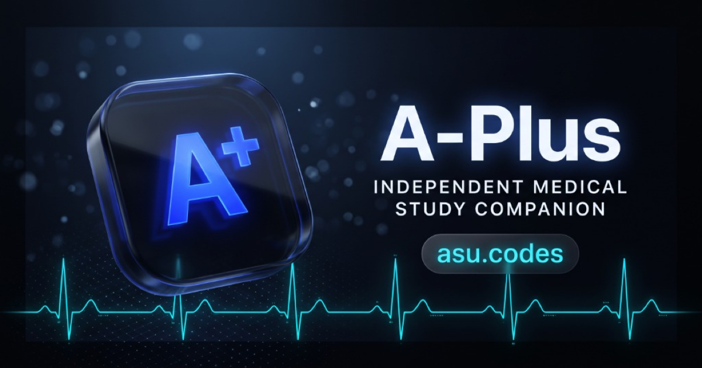

<p align="center">
  
</p>

# A-Plus (`A⁺`) — Independent Medical Study Companion

> **Canonical Web Platform:** [asu.codes](https://asu.codes)  
> *An independent, peer-maintained clinical study engine and question bank for medical students.*

---

## Overview

A-Plus is a high-speed, altruistic medical training portal built to solve fragmented PDF question banks. It provides chapter-by-chapter MCQs, clinical spotters, detailed explanations, and spaced repetition.

- **29,864+ Medically Audited Questions** across 42 modules (Years 1–3).
- **100% Free & Altruistic** — Zero paywalls, zero ads, zero corporate tracking.
- **Independent Student Initiative** — Built and maintained by Omar Hossam (Ain Shams Medical Student).
- **Apple Studio UI/UX** — Designed under [Apple Human Interface Guidelines](.agents/skills/apple-design/SKILL.md) for focus and high-contrast clinical scanning.

---

## Technology Stack

- **Frontend:** React 19, TypeScript, Vite, Tailwind CSS, Lucide Icons, Framer Motion
- **Database & Sync:** Supabase (PostgreSQL 15), Row-Level Security (RLS)
- **Authentication:** Clerk Auth with custom Obsidian branding
- **AI Medical Tutor:** Groq Llama 3.3 70B Versatile (real-time clinical explanations)
- **Deployment:** Vercel Edge Network (`https://asu.codes`)
- **Testing:** Vitest (171 test suites, 999 tests)

---

## Quick Start

```bash
# Install dependencies
npm install

# Start local development server
npm run dev

# Run comprehensive test suite
npm test

# Typecheck and build for production
npm run build
```

---

## Documentation & Maintainer Guides

- [Question intake and verified release](QUESTION_IMPORT_WORKFLOW.md)
- [Website navigation, Apple design and release checks](WEBSITE_UI_WORKFLOW.md)
- [Brand identity specification & design system](docs/BRANDING.md)
- [Master architecture encyclopedia](docs/ARCHITECTURE_ENCYCLOPEDIA.md)
- [Question schema & importer specification](data-format-v2/schema.md)
