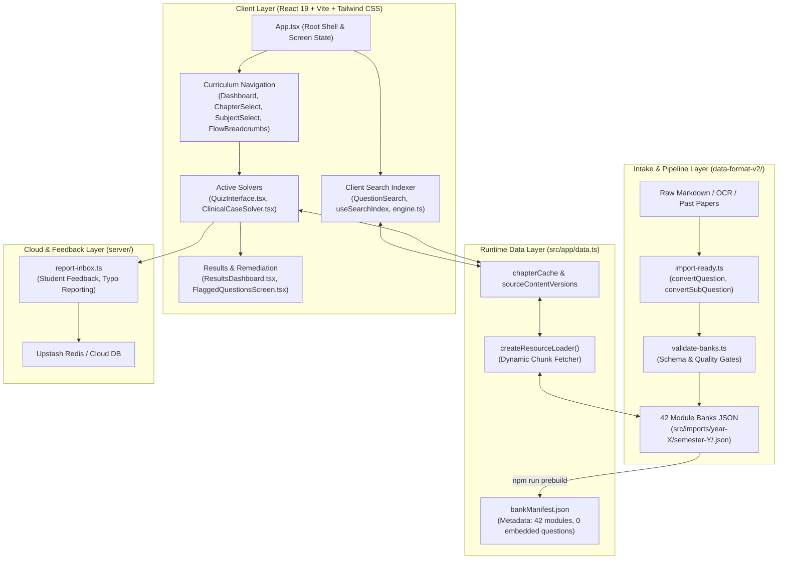

# ASU Medical Portal — Master Architectural Encyclopedia & System Specification

> **Target Audience:** All current and future AI coding agents, engineering leads, and medical content reviewers working on the ASU Medical Portal.  
> **Source of Truth:** Generated from deterministic AST analysis, semantic graph modeling, and empirical verification of the codebase (7,419 nodes, 12,139 edges, 1,073 communities).

---

## 1. System Overview & Core Philosophy

The **ASU Medical Portal** is a high-performance, mobile-first, offline-capable medical education platform engineered for students at Ain Shams University Faculty of Medicine. It hosts 42 integrated medical curriculum modules spanning Years 1 through 5, covering thousands of clinical vignettes, MCQs, True/False, Fill-in-the-Blank, Matching, and Essay questions.

### Core Architectural Axioms
1. **Zero Bundle Question Inlining:** Question banks are NEVER bundled into the JavaScript main thread. A prebuild generator compiles lightweight metadata (`bankManifest.json`); actual module banks are loaded dynamically on demand.
2. **Deterministic Content & Learning Hashes:** Question identities (`id`), content versions (`contentVersion`), and canonical learning hashes are decoupled. Server-side corrections overlay client questions seamlessly without invalidating ongoing user sessions.
3. **Strict Curriculum Hierarchy Integrity:**
   - **Integrated Modules:** `Chapter` (System/Block) → `Subject` (Discipline: Anatomy, Histology, Pathology, etc.) → `Questions`.
   - **Subject-First Modules:** `Subject` → `Topic` → `Questions`.
   - **Single-Branch Modules:** Chapters open directly to topics without redundant subject selector screens.
4. **Resumable State & Session Fingerprints:** Practice sessions maintain stable 20/40 question batch fingerprints, permitting seamless resumption across reloads and devices.
5. **Apple HIG & Accessible Design:** Touch targets $\ge 44\text{px}$, semantic light/dark mode tokens, zero UI sound toggle text clutter, and strict keyboard focusability.

---

## 2. High-Level System Architecture



---

## 3. The 7 Core Subsystems

### Subsystem 1: The App Shell & State Nexus (`src/app/App.tsx`)
[`src/app/App.tsx`](file:///Users/omarhossa/Documents/Medcine%20ASU/ASU-Medical-Portal/src/app/App.tsx) governs routing, auth integration (Clerk), and screen transitions:
- **Screen States:** `'dashboard'`, `'chapter'`, `'subject'`, `'topic-session'`, `'quiz'`, `'case'`, `'result'`, `'flagged'`, `'search'`, `'history'`.
- **The State Nexus (`QuizPayload`):** Defined at line 101, it is the universal carrier that bridges curriculum navigation with the solving engine:
  ```typescript
  interface QuizPayload {
    childAnchor?: string;
    chapter: ChapterData;
    subject: SubjectData | null;
    questions: Question[];
    savedSession?: QuizSessionSave;
  }
  ```
- **Result Transition (`ResultPayload`):** When a quiz completes, `QuizInterface` compiles user answers, elapsed time, and flagged items into `ResultPayload` (L109), triggering `ResultsDashboard.tsx`.

---

### Subsystem 2: Dynamic Bank Loader & Caching (`src/app/data.ts`)
[`src/app/data.ts`](file:///Users/omarhossa/Documents/Medcine%20ASU/ASU-Medical-Portal/src/app/data.ts) handles data loading without client bloat:
- **Prebuild Manifest (`bankManifest.json`):** Generated by [`scripts/generate-bank-manifest.mjs`](file:///Users/omarhossa/Documents/Medcine%20ASU/ASU-Medical-Portal/scripts/generate-bank-manifest.mjs). Records module code, year, semester, MCQ count, essay count, byte size, and SHA256 revision hash.
- **Resource Loader:** `bankLoader = createResourceLoader(...)` asynchronously loads `src/imports/.../<MODULE>.json` only when the student requests that module.
- **Visible Practice Filtering:** [`getChaptersForModuleAndMode()`](file:///Users/omarhossa/Documents/Medcine%20ASU/ASU-Medical-Portal/src/app/data.ts#L1031) wraps raw chapters through [`visiblePracticeChapters()`](file:///Users/omarhossa/Documents/Medcine%20ASU/ASU-Medical-Portal/src/app/lib/practiceOrder.ts), stripping empty lecture buckets and sorting by pedagogical order.

---

### Subsystem 3: The Active Solving Engine (`QuizInterface.tsx` & `ClinicalCaseSolver.tsx`)
1. **Standard Solving Engine ([`QuizInterface.tsx`](file:///Users/omarhossa/Documents/Medcine%20ASU/ASU-Medical-Portal/src/app/components/QuizInterface.tsx)):**
   - Supports single-choice MCQ, multi-select, True/False, Matching, and Fill-in-the-Blank.
   - Enforces interactive sound effects (`combo.mp3`, `correct.mp3`, `wrong.mp3`, `perfect.mp3`, `timer.mp3`) with strict adherence to the icon-only [`SoundToggle.tsx`](file:///Users/omarhossa/Documents/Medcine%20ASU/ASU-Medical-Portal/src/app/components/SoundToggle.tsx) policy.
   - Immediate feedback mode vs. Exam simulation mode with countdown timer ([`TimerSettingsPanel.tsx`](file:///Users/omarhossa/Documents/Medcine%20ASU/ASU-Medical-Portal/src/app/components/TimerSettingsPanel.tsx)).
2. **Clinical Case Solver ([`ClinicalCaseSolver.tsx`](file:///Users/omarhossa/Documents/Medcine%20ASU/ASU-Medical-Portal/src/app/components/ClinicalCaseSolver.tsx)):**
   - Specialized for progressive clinical vignettes.
   - Features pinned patient charts, lab results, imaging tabs, and sequential sub-questions (`-SQ1`, `-SQ2`) to prevent diagnostic foresight leakage.

---

### Subsystem 4: Client-Side Inverted Search Index (`src/app/search/`)
The search subsystem enables instant client-side full-text search across thousands of questions:
- **Search Engine ([`src/app/search/engine.ts`](file:///Users/omarhossa/Documents/Medcine%20ASU/ASU-Medical-Portal/src/app/search/engine.ts)):**
  - Tokenizes question stems, explanation rationales, and option texts.
  - Builds a compressed in-memory inverted index.
  - Supports fuzzy matching, query stemming, and token distance scoring.
- **Reactive Hook ([`useSearchIndex.ts`](file:///Users/omarhossa/Documents/Medcine%20ASU/ASU-Medical-Portal/src/app/search/useSearchIndex.ts)):**
  - Lazily compiles index entries upon module hydration.
  - Returns ranked question candidates with highlighted matching snippets.

---

### Subsystem 5: Question Intake & Validation Pipeline (`data-format-v2/`)
Governed by [`QUESTION_IMPORT_WORKFLOW.md`](file:///Users/omarhossa/Documents/Medcine%20ASU/ASU-Medical-Portal/QUESTION_IMPORT_WORKFLOW.md) and [`data-format-v2/schema.md`](file:///Users/omarhossa/Documents/Medcine%20ASU/ASU-Medical-Portal/data-format-v2/schema.md):
- **Normalizer ([`import-ready.ts`](file:///Users/omarhossa/Documents/Medcine%20ASU/ASU-Medical-Portal/data-format-v2/scripts/import-ready.ts)):**
  - `convertQuestion()` & `convertSubQuestion()`: Deterministically generate IDs (e.g., `IBM1-C01-S01-Q0042`), clean OCR stars/artifacts, normalize correct indexes, and enforce key concepts.
- **Automated Routing:** Matches lecture names against syllabus presets before fallback keyword routing. Maps ENT/Ophtha to clinical disciplines in `MSS-2`.
- **Strict Quality Validator ([`validate-banks.ts`](file:///Users/omarhossa/Documents/Medcine%20ASU/ASU-Medical-Portal/data-format-v2/scripts/validate-banks.ts)):**
  - Validates all 42 banks against the canonical JSON schema.
  - Guaranteed by 11 automated Vitest integration test suites.

---

### Subsystem 6: Performance, CWV & Session Resilience (`src/app/learning/`)
- **Core Web Vitals Optimization:**
  - Prevents main thread blocking on 500+ question modules by partitioning attempts into 20/40-question batch fingerprints.
  - Uses `attemptSnapshot.ts` (`freezeAttempt`, `restoreAttempt`) to save session states into LocalStorage and IndexedDB.
- **Learning Version Resolver ([`learningQuestionVersions.ts`](file:///Users/omarhossa/Documents/Medcine%20ASU/ASU-Medical-Portal/src/app/loading/learningQuestionVersions.ts)):**
  - Decouples client runtime IDs from server learning bank hashes.
  - Resolves questions against canonical hashes so students never lose progress when typos are fixed upstream.

---

### Subsystem 7: Serverless Error Reporting & Human-First Review (`server/`)
- **Report Inbox ([`server/report-inbox.ts`](file:///Users/omarhossa/Documents/Medcine%20ASU/ASU-Medical-Portal/server/report-inbox.ts)):**
  - Receives student reports on typos, ambiguous stems, or incorrect answer keys via [`ReportQuestion.tsx`](file:///Users/omarhossa/Documents/Medcine%20ASU/ASU-Medical-Portal/src/app/reports/ReportQuestion.tsx).
  - Backed by Upstash Redis with local memory fallbacks for development.
  - Human-first administration in [`AdminPortal.tsx`](file:///Users/omarhossa/Documents/Medcine%20ASU/ASU-Medical-Portal/src/pages/AdminPortal.tsx) without AI mediation or filtering.
- **On-The-Spot Question Editing ([`InlineQuestionEditor.tsx`](file:///Users/omarhossa/Documents/Medcine%20ASU/ASU-Medical-Portal/src/app/components/InlineQuestionEditor.tsx)):**
  - Enables instant inline patch editing of question stem, choices, designated correct answer, and faculty explanation without opening the full question bank or navigating away.
  - Writes live overrides via `PATCH /api/question-bank` into Redis overlay `asu_question_edits:v1:${moduleCode}`.
- **Direct Student Email Communication ([`StudentEmailReplyModal.tsx`](file:///Users/omarhossa/Documents/Medcine%20ASU/ASU-Medical-Portal/src/app/components/StudentEmailReplyModal.tsx)):**
  - Provides pre-filled faculty response templates and direct mailto actions to communicate verification decisions to students.

---

### Subsystem 8: Exclusive Owner Deep Analytics & Real-Time Presence (`server/admin-analytics-service.ts`)
- **Access Guard:**
  - Strictly restricted to owner account `omarhmaged@gmail.com`.
  - Non-owner requests return 403 Forbidden with zero data leakage.
- **Real-Time Student Presence Engine ([`presence-service.ts`](file:///Users/omarhossa/Documents/Medcine%20ASU/ASU-Medical-Portal/server/presence-service.ts) & [`usePresence.ts`](file:///Users/omarhossa/Documents/Medcine%20ASU/ASU-Medical-Portal/src/app/hooks/usePresence.ts)):**
  - Clients send a lightweight 60s presence heartbeat (`POST /api/presence`) with active tab visibility detection.
  - Redis Sorted Set `asu_presence:v1:heartbeat` maintains rolling 5-minute active presence window with auto-pruning.
  - Live **Online Right Now** KPI card with pulsing emerald indicator and optional 15-second live presence auto-refresh.
- **Comprehensive Intelligence Suite ([`AdminAnalyticsView.tsx`](file:///Users/omarhossa/Documents/Medcine%20ASU/ASU-Medical-Portal/src/pages/admin/AdminAnalyticsView.tsx)):**
  - **Executive Overview:** Real-time online student count, enrolled totals, active today count, questions solved across 42 banks, platform accuracy %, and total logged study hours.
  - **Student Directory:** Searchable roster with real details: live online status badge, academic year, XP, level, study streak, accuracy %, total study duration, weakest module, and expandable per-module performance breakdown.
  - **Module Deep-Dive:** Complete table across all 42 modules with total bank questions, student attempts, pass rate, active learners, and difficulty ratings.
  - **Hardest Questions Ranking:** Top 25 most failed questions with difficulty gauges and 1-click on-the-spot editing capability.

---

### Subsystem 9: Knowledge Graph Topic Explorer & Cloud Sync Indicator
- **Curriculum Concept Graph ([`knowledgeGraphService.ts`](file:///Users/omarhossa/Documents/Medcine%20ASU/ASU-Medical-Portal/src/app/services/knowledgeGraphService.ts)):**
  - Connects questions, chapters, and topics to the 7,419-node curriculum knowledge graph across 9 medical disciplines.
  - Interactive in-quiz concept map drawer ([`KnowledgeGraphDrawer.tsx`](file:///Users/omarhossa/Documents/Medcine%20ASU/ASU-Medical-Portal/src/app/components/KnowledgeGraphDrawer.tsx)) and standalone curriculum explorer ([`KnowledgeGraphPage.tsx`](file:///Users/omarhossa/Documents/Medcine%20ASU/ASU-Medical-Portal/src/pages/KnowledgeGraphPage.tsx)).
- **Cross-Device Cloud Sync Expansion ([`UserSyncPill.tsx`](file:///Users/omarhossa/Documents/Medcine%20ASU/ASU-Medical-Portal/src/app/components/UserSyncPill.tsx)):**
  - Reactive sync status pip in the user profile avatar (green dot for synced, pulsing amber for syncing, gray for offline, red for error).
  - Manual "Force Sync Now" trigger and accessible tooltips conforming to Apple HIG.

---

### Subsystem 10: Timed Mock Exam Simulator & Apple Liquid Glass Module Hub
- **Unified Module Command Hub ([`StudyMode.tsx`](file:///Users/omarhossa/Documents/Medcine%20ASU/ASU-Medical-Portal/src/pages/StudyMode.tsx)):**
  - Apple Liquid Glass design replacing outdated static mode cards and neon waveforms.
  - Interactive SVG circular mastery ring with live accuracy and question counts computed from `LearningContext`.
  - 1-Click instant "Resume Chapter Practice" / "Start Practice" eliminating intermediate navigation friction.
  - **2x2 Bento Action Grid:**
    1. *Curriculum Chapters & Topics* (`mcq` mode)
    2. *Timed Mock Exam Simulator* (in-place Ain Shams testing engine)
    3. *Official Past Papers & Continuous Assessments* (`mixed` past paper mode)
    4. *Syllabus & Lecture Tracker* (`tracker` route)
    5. *Adaptive Case-Based Essays* (automatically hidden when module has 0 essays to prevent empty dead ends).
- **Proportional Curricular Question Sampling ([`mockExamGenerator.ts`](file:///Users/omarhossa/Documents/Medcine%20ASU/ASU-Medical-Portal/src/app/utils/mockExamGenerator.ts)):**
  - Balanced question allocation proportionally sampled across all faculty disciplines (Anatomy, Physiology, Pathology, Pharmacology, etc.) with Fisher-Yates randomization.
- **Ain Shams Grading Engine ([`mockExamGrading.ts`](file:///Users/omarhossa/Documents/Medcine%20ASU/ASU-Medical-Portal/src/app/utils/mockExamGrading.ts)):**
  - Maps score percentages to the official Ain Shams Faculty of Medicine grading curve:
    - $A^+ \ge 90\%$ (GPA 4.0, Excellent)
    - $A \ge 85\%$ (GPA 3.7, Excellent)
    - $B^+ \ge 80\%$ (GPA 3.3, Very Good)
    - $B \ge 75\%$ (GPA 3.0, Very Good)
    - $C^+ \ge 70\%$ (GPA 2.7, Good)
    - $C \ge 65\%$ (GPA 2.4, Good)
    - $D \ge 60\%$ (GPA 2.0, Passing)
    - $F < 60\%$ (GPA 0.0, Fail)
- **Active Simulation Runner ([`MockExamRunner.tsx`](file:///Users/omarhossa/Documents/Medcine%20ASU/ASU-Medical-Portal/src/app/components/mock/MockExamRunner.tsx)):**
  - Realistic testing center interface with floating countdown timer pill, dynamic warning colors, quick question palette drawer with flagged status, Apple HIG keyboard navigation (`1-4`, `A-D`, `F` to flag, arrow keys), and auto-submission on timer expiry.
- **Faculty Analytics & Remediation Report ([`MockExamResultsView.tsx`](file:///Users/omarhossa/Documents/Medcine%20ASU/ASU-Medical-Portal/src/app/components/mock/MockExamResultsView.tsx)):**
  - Ain Shams grade badge, pace analytics (average sec/Q, fastest vs slowest question), discipline mastery radar breakdown, question review drawer (All / Incorrect / Flagged), and 1-click **"Retry Missed Questions"** generator.

---

## 4. Canonical Module Catalog (42 Banks)

| Year | Semester | Module Code | Full Module Name | Type |
| :---: | :---: | :---: | :--- | :--- |
| **Year 1** | Sem 1 | `IBM-1` | Introduction to Medical Biochemistry | Integrated Foundation |
| **Year 1** | Sem 1 | `IAE-1` | Introduction to Anatomy & Embryology | Integrated Foundation |
| **Year 1** | Sem 1 | `IHC-1` | Introduction to Histology & Cytology | Integrated Foundation |
| **Year 1** | Sem 1 | `IPHY-1`| Introduction to Physiology | Integrated Foundation |
| **Year 1** | Sem 1 | `MBMG-1`| Molecular Biology & Medical Genetics | Integrated Foundation |
| **Year 1** | Sem 1 | `MIM-1` | Medical Immunology | Integrated Foundation |
| **Year 1** | Sem 1 | `P1-1`  | Professionalism 1 | Longitudinal |
| **Year 1** | Sem 2 | `BLS-HE-1` | Blood & Lymphatic System | System-Based |
| **Year 1** | Sem 2 | `IPAT-1`| Introduction to Pathology | Integrated Foundation |
| **Year 1** | Sem 2 | `IPHA-1`| Introduction to Pharmacology | Integrated Foundation |
| **Year 1** | Sem 2 | `MINF-1`| Medical Informatics | Applied Science |
| **Year 1** | Sem 2 | `MLS-1` | Musculoskeletal System 1 | System-Based |
| **Year 1** | Sem 2 | `P2-1`  | Professionalism 2 | Longitudinal |
| **Year 2** | Sem 1 | `MBL-2` | Basic Life Support | Clinical Foundation |
| **Year 2** | Sem 1 | `MCVS-2`| Cardiovascular System | System-Based |
| **Year 2** | Sem 1 | `MRS-2` | Respiratory System | System-Based |
| **Year 2** | Sem 2 | `MCNS-2`| Central Nervous System | System-Based |
| **Year 2** | Sem 2 | `MEM-2` | Endocrine & Metabolic System | System-Based |
| **Year 2** | Sem 2 | `MSS-2` | Special Senses (ENT & Ophthalmology) | System-Based |
| **Year 2** | Sem 2 | `P3-2`  | Professionalism 3 | Longitudinal |
| **Year 2** | Sem 2 | `R-2`   | Research Methodology 2 | Longitudinal |
| **Year 3** | Sem 1 | `MGL-3` | Gastrointestinal & Liver System (6,539 Qs: 5,622 Practice, 670 CA-1, 247 CA-2) | System-Based |
| **Year 3** | Sem 1 | `MUG-3` | Urogenital System | System-Based |
| **Year 3** | Sem 1 | `P4-3`  | Medical Ethics | Longitudinal |
| **Year 3** | Sem 1 | `R-3`   | Scientific Research | Longitudinal |
| **Year 3** | Sem 2 | `CEO-3` | Clinical Epidemiology & Oncology | Clinical Block |
| **Year 3** | Sem 2 | `FT-3`  | Forensic Medicine & Toxicology | Clinical Block |
| **Year 3** | Sem 2 | `MED1-3`| Internal Medicine 1 | Clinical Block |
| **Year 3** | Sem 2 | `ORL-3` | Otorhinolaryngology | Clinical Block |
| **Year 3** | Sem 2 | `P5-3`  | Doctor-Patient Communication | Longitudinal |
| **Year 3** | Sem 2 | `P6-3`  | Patient Safety | Longitudinal |
| **Year 4** | Sem 1 | `FAM-4` | Family Medicine | Clinical Clerkship |
| **Year 4** | Sem 1 | `MED2-4`| Internal Medicine 2 | Clinical Clerkship |
| **Year 4** | Sem 1 | `P7-4`  | Professionalism 7 | Longitudinal |
| **Year 4** | Sem 2 | `MED3-4`| Internal Medicine 3 | Clinical Clerkship |
| **Year 4** | Sem 2 | `PED-4` | Pediatrics | Clinical Clerkship |
| **Year 5** | Sem 1 | `EM1-5` | Emergency Medicine 1 | Clinical Clerkship |
| **Year 5** | Sem 1 | `OO-5`   | Obstetrics & Gynecology 1 | Clinical Clerkship |
| **Year 5** | Sem 1 | `SUR1-5`| General Surgery 1 | Clinical Clerkship |
| **Year 5** | Sem 2 | `EM2-5` | Emergency Medicine 2 | Clinical Clerkship |
| **Year 5** | Sem 2 | `OG-5`   | Obstetrics & Gynecology 2 | Clinical Clerkship |
| **Year 5** | Sem 2 | `SUR2-5`| General Surgery 2 | Clinical Clerkship |

---

## 6. Admin Command Center, Analytics & Master Leaderboard Subsystems

The ASU Medical Portal features a private command center located at `/admin` and `/admin/analytics`, built strictly for portal administrator `omarhmaged@gmail.com`.

### 6.1 Security & Authentication Architecture
- **Cryptographic Owner Verification:** Enforced at both the edge API handler (`api/admin-analytics.ts`) and backend service layer (`server/admin-analytics-service.ts`). Calls verify Clerk JWT tokens and ensure verified ownership matches `omarhmaged@gmail.com`. Unauthorized requests fail immediately with HTTP 401/403.
- **Private Cache Policies:** All analytics endpoints emit `Cache-Control: private, no-store` and `X-Content-Type-Options: nosniff`.

### 6.2 Real-Time Online Presence Engine
- **Heartbeat Tracking:** Powered by Redis sorted set `asu_presence:v1:heartbeat` scoring user active timestamps.
- **5-Minute Rolling Window:** Clients emit periodic 60-second heartbeats (`usePresence.ts`) with current active module metadata. Users inactive for $> 5$ minutes automatically age out of the active set.

### 6.3 Admin Master Leaderboard & Student Search
- **Universal Cohort Visibility:** Unlike student-facing leaderboards that display opted-in aliases, the Admin Master Leaderboard displays **all registered accounts** with real student names, emails, academic cohort years, and Clerk user IDs.
- **Dynamic Multi-Metric Ranking:** Dynamically re-ranks the entire cohort in real time by:
  1. `Total XP` (Default)
  2. `Questions Solved`
  3. `Accuracy %`
  4. `Study Hours`
  5. `Study Streak`
- **Top-3 Podium Showcase:** Prominently highlights the #1 Gold Champion (`🥇`), #2 Silver Contender (`🥈`), and #3 Bronze Achiever (`🥉`) in an Olympic-style podium layout with custom glassmorphism borders and dynamic metric badges.
- **In-Place Deep Inspection:** Each student card expands in-place to reveal individual performance metrics across all attempted modules, highlighting weakest subject areas.
- **1-Click Student Outreach:** Integrated with `StudentEmailReplyModal` providing tailored email templates for *Academic Recognition (Top Performer)*, *Study Guidance & Module Support*, and *Faculty Inquiries*.

### 6.4 Human-First Question Studio & On-The-Spot Editor
- **Direct Human Review:** Replaced automated AI pre-triage with clean, unhindered faculty review workflows.
- **Inline Editing:** Administrators can edit question stems, choices, designated correct answer indices, and detailed clinical explanations directly within the analytics reports without reloading question banks.

### 6.5 Zero-Loss Student Question Reporting Architecture
The student reporting pipeline (`server/report-question.ts`, `server/report-store.ts`, `server/report-service.ts`, `api/question-reports.ts`) guarantees that no student feedback is dropped, rejected, or lost under network or storage degradation:
- **Two-Pass Chapter Resolution:** Resolves questions strictly against client-provided chapter IDs first, falling back immediately to a complete scan across all module chapters. Prevents false 404s when practice assessments or exam configurations use synthetic or differing chapter identifiers (e.g. CA-2 vs practice bank).
- **Isolated Redis Dynamic Edits Lookup:** Wrapping live Redis edit overlays in isolated fault barriers ensures temporary key-value store slowdowns or disconnections never impede question intake.
- **In-Memory & Spool Fallback Queue:** If Upstash Redis is unreachable or unconfigured, reports are automatically stored in an in-memory queue (`fallbackReports`), returning an immediate HTTP 200/201 success confirmation to the student. Fallback reports seamlessly merge into admin list and status queries.
- **Auth Resilience:** Student authentication resolves valid JWT token claims directly if external Clerk REST endpoints experience latency, preserving reporting availability.
- **Direct Faculty Review Trust:** Student reporting interface reflects human-first faculty review, explicitly removing legacy AI review references.

### 6.6 Edge & Serverless Security Architecture
- **Origin Reflection Protection:** Token verification across serverless functions (`api/sync.ts`, `server/admin-analytics-service.ts`) enforces strict whitelists of verified production domains (`https://asu.codes`, `https://www.asu.codes`, `https://asu-medicine.vercel.app`) without reflecting unverified request `Origin` headers into authorized parties.
- **Fail-Closed Cron & Service Authentication:** Maintenance routes (`api/cron-maintenance.ts`) fail closed with HTTP 500 if `CRON_SECRET` is unset, and HTTP 401 if unauthorized tokens are presented.
- **Fail-Closed Admin Secrets:** Administrative verification rejects token validation when `CLERK_SECRET_KEY` is missing, prohibiting static or hardcoded fallback keys.
- **Rate-Limited & Sanitized Telemetry:** Presence heartbeats (`api/presence.ts`, `server/presence-service.ts`) sanitize user IDs against strict alphanumeric expressions ($\le 64$ characters), preventing Redis memory flooding attacks.
- **Content Security Policy & Modern Transport:** `vercel.json` enforces HSTS (`max-age=63072000; includeSubDomains; preload`), strict Content Security Policy (`default-src 'self'`, whitelisted Clerk/Upstash/AI endpoints, `frame-ancestors 'self'`), COOP (`same-origin-allow-popups`), and CORP (`same-origin`).
- **Apple-Design Security UI:** The client integrates an Apple HIG-compliant glassmorphic security notification system (`SecurityNoticeToast.tsx`) with $\ge 44\text{px}$ touch targets, smooth spring motion, and WCAG AAA contrast for auth challenge handling and rate-limiting alerts.

Whenever an agent makes modifications to this codebase, they **MUST** obey the following iron rules:

1. **The Question Intake Law:**
   - Always run `npx tsx data-format-v2/scripts/validate-banks.ts` after adding or updating any questions.
   - Run vitest integration tests: `npx vitest run src/app/import-routing.test.ts`.
   - Never use `git add .` on intake changes; stage only the reviewed files.
2. **The Documentation Synchronization Law:**
   - Any schema, intake script, or subject change must be reflected across [`data-format-v2/schema.md`](file:///Users/omarhossa/Documents/Medcine%20ASU/ASU-Medical-Portal/data-format-v2/schema.md), [`HOW_TO_USE.md`](file:///Users/omarhossa/Documents/Medcine%20ASU/ASU-Medical-Portal/data-format-v2/HOW_TO_USE.md), [`import-workflow.md`](file:///Users/omarhossa/Documents/Medcine%20ASU/ASU-Medical-Portal/data-format-v2/import-workflow.md), and [`ADDING_QUESTIONS.md`](file:///Users/omarhossa/Documents/Medcine%20ASU/ASU-Medical-Portal/ADDING_QUESTIONS.md).
3. **The Apple HIG & Sound Toggle Law:**
   - Never render text beside the quiz sound toggle; keep it strictly icon-only with accessible ARIA labels.
   - Touch targets must never fall below 44×44px on mobile viewports.
   - Do not reintroduce subject color-coding legend boxes.
4. **The Git Push Law:**
   - NEVER execute `git push` unless specifically and explicitly commanded by the user in that prompt.
