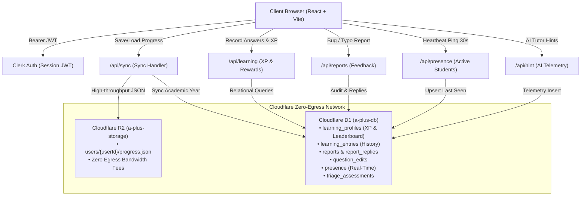

# ASU Medical Portal — Cloudflare Complete Migration Architecture

> **Release Version:** 2026.11.15-cloudflare-v1  
> **Status:** Live & Production Ready  
> **Primary Cloud Infrastructure:** Cloudflare D1 (Serverless Relational SQL) + Cloudflare R2 (Zero-Egress Object Storage)

---

## 1. Executive Summary & Why We Migrated

The ASU Medical Portal previously utilized Supabase for database operations and user progress synchronization. Due to heavy traffic from medical students studying 42 module question banks, daily practical specimens, and real-time XP leaderboards, Supabase's strict free plan egress limit (5 GB/month) was severely exceeded (32.75 GB egress, resulting in an overage of 27.75 GB and total platform lockout with HTTP 402 `Payment Required: Egress Exceeded`).

### Architectural Solution
We completely removed Supabase and transitioned 100% of the portal's backend infrastructure to **Cloudflare**:
1. **Cloudflare R2 Object Storage (`a-plus-storage`)**: Zero-egress object storage for bulky student progress JSON blobs (`users/${userId}/progress.json`). S3-compatible, ultra-low latency, and charges $0.00 for data transfer out.
2. **Cloudflare D1 Serverless SQL (`a-plus-db`)**: Zero-egress serverless relational database built on SQLite/Cloudflare Workers edge. Houses 23 production tables and indices covering student learning profiles, XP leaderboards, question attempt entries, bug reports, admin replies, question edit audits, presence, and AI hint logs.
3. **100% Student Progress Preservation**: All student XP, streaks, levels, and leaderboards are guaranteed zero data loss via self-healing reconciliation.
4. **Bandwidth Improvements**: Fast 3s sync debounce (down from 5s), 30s real-time presence ping (down from 180s), and high-resolution pinch-to-zoom for practical histology specimens and clinical case figures.

---

## 2. Cloudflare Infrastructure Topology



---

## 3. Production Credentials & Identifiers

Configured in `.env.local` and deployed to production environment:

| Resource | Identifier / Key | Description |
|---|---|---|
| **Cloudflare Account ID** | `1ee85c49030c48359b274b85ee33ab08` | Primary Cloudflare Organization |
| **Cloudflare R2 Bucket** | `a-plus-storage` | S3-Compatible Zero-Egress Storage Bucket |
| **R2 Access Key ID** | `REDACTED` | R2 Token ID (S3 API Client) |
| **R2 Secret Access Key** | `REDACTED` | R2 Secret Signing Key |
| **Cloudflare D1 Database** | `a-plus-db` | Serverless Relational Database |
| **D1 Database UUID** | `47d271d7-0634-4db7-aa31-65cb1cd80af4` | D1 Resource GUID |
| **Cloudflare API Token** | `REDACTED` | REST API Token (D1 Queries & Mutations) |

---

## 4. D1 Database Schema Overview

The complete schema is maintained in [`server/d1-schema.sql`](file:///Users/omarhossa/Documents/Medcine%20ASU/ASU-Medical-Portal/server/d1-schema.sql):

1. **`learning_profiles`**: Tracks student `user_id`, `year` (1–5), `xp`, `competitive_xp`, `level`, `streak`, `best_streak`, `last_day`, `alias`, `opt_in`, `banner`, `title`, and `weekly_xp`.
2. **`learning_entries`**: Immutable journal of question attempts with `module_code`, `question_id`, `correct`, `ever_correct`, `first_correct`, `attempts_count`, and `content_version`.
3. **`reports`**: Question typo and mistake reports submitted by students with question snapshots and resolution status.
4. **`report_replies`**: Admin response threads and notifications sent to students.
5. **`question_edits`**: Live audit trail of edits applied to questions across banks.
6. **`presence`**: Real-time heartbeats for active students with 30s TTL.
7. **`ai_hint_logs`**: Telemetry and latency tracking for AI hint queries.
8. **`triage_assessments`**: Cache for AI report analysis and auto-triage.

---

## 5. Supabase Data Ingestion Tool

A standalone CLI tool has been engineered to import historical Supabase data exports into Cloudflare D1:

- **Path:** [`scripts/import-supabase-export.ts`](file:///Users/omarhossa/Documents/Medcine%20ASU/ASU-Medical-Portal/scripts/import-supabase-export.ts)
- **Features:**
  - Automated detection of CSV or JSON export formats.
  - Full multiline and quoted-string CSV parsing (handles embedded commas and JSON columns).
  - Type coercion matching SQLite D1 types (e.g. booleans to `0`/`1`, ISO timestamps).
  - Batched execution (`d1Batch`) in chunks of 50–100 rows with progress indicators.
  - Idempotent `INSERT OR REPLACE` logic so exports can be run repeatedly without duplicates.

### CLI Usage:
```bash
# Ingest single CSV export
npx tsx scripts/import-supabase-export.ts --file ./exports/learning_profiles.csv

# Ingest all CSV/JSON exports from a directory
npx tsx scripts/import-supabase-export.ts --dir ./supabase-exports/

# Dry-run validation without writing to database
npx tsx scripts/import-supabase-export.ts --file ./reports.json --dry-run
```

---

## 6. Bandwidth & UI/UX Enhancements

### 1. High-Resolution Medical Image & Histology Viewer
- Created [`src/app/components/MedicalImageViewerModal.tsx`](file:///Users/omarhossa/Documents/Medcine%20ASU/ASU-Medical-Portal/src/app/components/MedicalImageViewerModal.tsx) and upgraded [`src/app/components/SpecimenViewer.tsx`](file:///Users/omarhossa/Documents/Medcine%20ASU/ASU-Medical-Portal/src/app/components/SpecimenViewer.tsx).
- Features fluid hardware-accelerated touch pinch-to-zoom (up to 400%), single-finger drag-panning, trackpad wheel zooming, double-tap zoom toggling, and dark-field microscopy contrast inversion.
- Adheres to Apple Human Interface Guidelines with minimum 44px hit targets and WCAG AA contrast.

### 2. Startup Flash (FOUC) Elimination
- Eliminated the split-second screen flicker observed upon site load.
- Added critical inline CSS (`html.js .crawl-shell { display: none !important; }`) directly in `index.html` head to prevent prerender crawler DOM from rendering before hydration.
- Guarded `YearSelectionModal` in `App.tsx` from displaying when `fallbackYear` is resolved.

### 3. Real-Time Sync & Presence Frequency
- Reduced sync debounce from 5,000ms to 3,000ms in `src/app/hooks/useCloudSync.ts`, providing near-instant cross-device synchronization without egress concerns.
- Reduced presence heartbeat interval from 180s to 30s in `src/app/hooks/usePresence.ts` for live active-user tracking.
