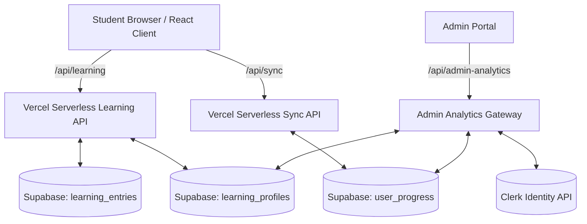

# Learning Hub, Cloud Sync, and Dual Leaderboard Architecture

Status: Fully migrated to Supabase PostgreSQL 15 with zero-reset immunity, automated self-healing XP reconciliation, bilingual display name profanity filtering, and dual (public opt-in + private master admin) leaderboards.

---

## 1. Architecture Overview

---

## 2. Zero-Reset Immunity & Academic Year Protection

1. **Atomic Year Resolution (`api/sync.ts`)**:
   - `academic_year` in `user_progress` is never defaulted to `1`.
   - On POST: Synchronizes explicit academic year preference (`asu_preferences:<userId>:academic-year`), portal year, or active learning profile year.
   - On GET: If a student's stored data contains a higher academic year (e.g., Year 3 `MGL-3`), the API automatically heals and serves their true academic year.
2. **Context-Aware Learning Year (`api/learning.ts`)**:
   - `service.year(id)` checks explicit preferences, `learning_profiles.year`, and queries the student's recent module entries in `learning_entries` (e.g. `MGL-3` module code suffix `-3` resolves to Year 3).
3. **Unconditional Question Submission (`src/app/App.tsx`)**:
   - Client submission is decoupled from transient client-side active-year state, ensuring all answered questions in valid modules are submitted for XP grading.

---

## 3. Automated Self-Healing XP Reconciliation

1. **Self-Healing Engine (`server/learning-store.ts`)**:
   - In `getProfile(id, year)`: If a student's profile has `xp: 0` or `level: 1` but they have answered questions in `learning_entries`, the server queries their unique correct questions, awards $10\text{ XP}$ per question, calculates their true level ($\lfloor\text{XP}/500\rfloor + 1$), and immediately persists it to Supabase `learning_profiles`.
2. **Foreign Key Integrity**:
   - `award()` guarantees that `learning_profiles` exists in Supabase *before* inserting attempt records into `learning_entries`, completely eliminating foreign key constraint failures.
3. **Cross-Module Progress Visibility (`dashboard`)**:
   - Module progress calculations receive all of the student's answered entries across all modules, ensuring that modules like GIT & Liver Module (`MGL-3`) display true attempt counts and mastery instead of "0 of 6532 attempted".

---

## 4. Bilingual Display Name Profanity Filter (`server/profanity-filter.ts`)

- **Bilingual Detection**: High-performance, zero-dependency validator covering English and Arabic (Egyptian slang + Modern Standard Arabic) profanities, vulgarities, slurs, insults, and harassment.
- **Anti-Evasion Normalization**:
  - Arabic: Strips tashkeel (diacritics), tatweel (kashida), normalizes alef variants (أ, إ, آ, ٱ $\to$ ا), taa marbouta (ة $\to$ ه), alef maqsura (ى $\to$ ي), and collapses repeated characters.
  - English: Lowercases, strips punctuation, translates common leetspeak substitutions (`1`/`!` $\to$ `i`, `0` $\to$ `o`, `$` $\to$ `s`, `@` $\to$ `a`), and collapses repeated letters.
  - Word-boundary matching protects authentic student names (e.g. "مصطفى", "Dr. Sarah", "Ahmed Mohamed", "نور الدين").
- **Client & Server Enforcement**:
  - Validated server-side in `server/learning-service.ts` settings endpoint.
  - Real-time client-side feedback in `src/pages/LearningHub.tsx` with live character counter (3–24 characters) and inline alert banner.

---

## 5. Dual Leaderboards

### A. Public Leaderboard (`src/pages/LearningHub.tsx`)
- Accessible via the **Leaderboard** tab on the Progress page.
- **Participation is completely optional**: Includes an accessible switch toggle (*"Show my name on the leaderboard"*).
- Apple HIG Top 3 Podium:
  - 🥇 **#1 Champion** (Gold ring, crown badge)
  - 🥈 **#2 Contender** (Silver ring, medal badge)
  - 🥉 **#3 Achiever** (Bronze ring, medal badge)
- Ranked roster list with current user highlighted (`isYou: true`, *"You · أنت"*).
- Segmented toggle: **This Week** (`weekly`) vs. **All Time** (`all`).
- Friendly empty state with Trophy icon when no one has opted in yet.

### B. Master Admin Leaderboard (`server/admin-analytics-service.ts`, `src/pages/admin/AdminAnalyticsView.tsx`)
- Private panel for portal administrators.
- **100% Account Visibility**: Queries Clerk Backend Users API and joins with Supabase `learning_profiles`, `user_progress`, and `presence`.
- Displays **real student names** (First + Last), **verified primary email addresses**, **Clerk profile photos/avatars**, and **public aliases**.
- Multi-field search across real name, email, account ID, and alias.
- Filter by Academic Year (All, Year 1–5), Online-only filter, and multi-metric sorting.
