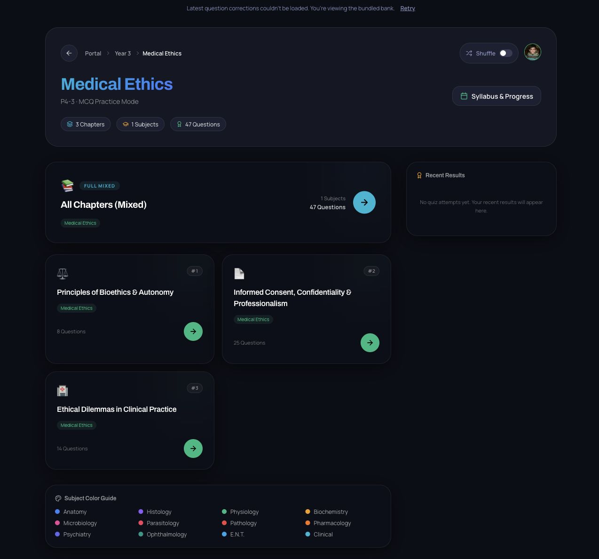

# Year 3 / Semester 1 / Medical Ethics (P4-3)

Prepared and applied locally on 11 October 2026. No commit, push or production deployment was performed.

## Outcome

| Item | Count |
| --- | ---: |
| Designated PDFs | 5 |
| Physical pages visually inspected | 24 |
| Source occurrences (including redacted placeholders) | 104 |
| Unique source groups | 74 |
| Accepted unique MCQs added | 47 |
| Repeated source copies consolidated, across all groups | 30 |
| Unique questions withheld | 27 |
| Historical key corrected | 1 |

Conservation: **104 = 47 accepted unique + 30 duplicate copies + 27 withheld unique**. Within the accepted material, 63 occurrences map to the 47 released questions (16 duplicates). The withheld archive contains 41 occurrences (27 unique and 14 duplicates). None of the source occurrences disappeared. The existing Ethics bank contained zero questions, so no existing question IDs were removed.

The module is active with the catalog’s 1.5 credit points / 30 marks. Existing chapter IDs and titles were retained. The old empty-bank metadata used 1 credit / 20 marks; it was aligned with the actual Year 3 catalog.

| Existing chapter | Added MCQs |
| --- | ---: |
| Principles of Bioethics & Autonomy | 8 |
| Informed Consent, Confidentiality & Professionalism | 25 |
| Ethical Dilemmas in Clinical Practice | 14 |

Each chapter uses the canonical `clinical` subject ID, displayed as Medical Ethics, and a named topic with a valid local lecture index. No lecture timetable or textbook pagination was inferred from the PDFs. Their original exam dates, forms, numbering resets and old Year 2 labels remain in the provenance ledger; the requested destination is the catalog’s Year 3 / Semester 1 module. Exam occurrence provenance is retained in sidecars under the existing Ethics topic hierarchy. The dedicated practice/past-exam collection separation is a GIT-specific layout and was not imposed on Ethics.

## Extraction and duplicate decisions

Original PDFs were copied without modification, hashed, rendered and read page by page. Image-only pages were OCRed, but visual reading controlled the transcription. BG1 question 6 continues onto its second page. BG2 contains three opaque boxes over questions 7, 10 and 12 and their key entries; those questions were recorded as incomplete rather than reconstructed. BG3 has malformed option labels E/F/G; answer positions were determined from the visible choice content. The 2020 examination appears in two separate source PDFs and also overlaps the BG collection.

Duplicates were decided after occurrence capture. A question was merged only when the task, complete choice set and clinical meaning were equivalent. Reordered choices were mapped by their content. Variants with different choices were retained separately, including the two adverse-effect principle questions and the two impaired-physician reporting questions. Source-copy repetition is recorded in the audit rather than presented as a count of independent examinations.

## Answer review and editorial changes

Every released question was reviewed option by option using actually opened authoritative text. The final stem, choices, answer and explanation are bound to a SHA-256 review hash. All 47 hashes matched the staged conversion and the applied bank. This was a **nonblind Codex self-review**; no independent reviewer or expert adjudication was performed. Technical verification does not prove medical correctness.

The source-marked answer for `ETH-D03-Q03` was the combined “cannot read/write and under threat” choice (index 3). The released answer is “Is under threat” (index 1). Illiteracy alone does not invalidate consent; the precise review evidence is [GMC supporting decision making](https://www.gmc-uk.org/professional-standards/the-professional-standards/decision-making-and-consent/the-dialogue-leading-to-a-decision-continued-1), paragraphs 27–30, and [WMA consent guidance](https://www.wma.net/policies-post/wma-international-code-of-medical-ethics/), paragraph 15.

Editorial and contextual changes are individually recorded in `medical-decisions.json`, including expanding letter-combination choices into words, cleaning grammar, naming the Egyptian framework in the research-consent stem, and clarifying civil-malpractice and ordinary expert-evidence scope. The altered final versions were reviewed and hashed. Historical highlights, dots and grids were preserved separately and never treated as proof of correctness.

Egypt-specific answers use the official [Egyptian Health Council medical ethics charter](https://www.ehc.gov.eg/ar/ethics-medicine), with the relevant article identified in each decision. Reproductive rulings distinguish the charter from Dar al-Ifta’s interpretation. UK/US guidance supports general clinical concepts, not an unstated claim about Egyptian law. Search snippets, inaccessible pages and unrelated sources were not used as accepted claim evidence.

## Withheld questions

These 27 unique groups are archived and excluded from the student-facing bank. The exact IDs, source choices, historical keys and follow-up requirements are in `exclusions.json` and `source-accounting.json`.

- **ETH-D01-Q01** (1 occurrence(s)): Other groups may also require consent unless a specific compulsory-examination law applies; that exception is not stated or verified for all options.
- **ETH-D01-Q02** (5 occurrence(s)): Urgency and absent relatives do not establish that the patient cannot consent; the emergency exception needs capacity/known-refusal conditions absent from the stem.
- **ETH-D01-Q06** (1 occurrence(s)): An injury can be nonpreventable in one respect while a negligent breach causes compensable harm in another; the purported false option is not unambiguously false.
- **ETH-D01-Q08** (1 occurrence(s)): Egypt-specific legal death criteria require a verified controlling statute and irreversibility/context; the historical all-vital-functions key cannot be safely accepted as a general rule.
- **ETH-D02-Q01** (3 occurrence(s)): Bioethics is broader than professional interactions; variation by religion/society and the narrow professional-interaction definition make the offered single best answer unsafe.
- **ETH-D02-Q05** (3 occurrence(s)): Student examination requires agreement, but the other groups are not automatically exempt from consent; missing jurisdiction-specific compulsory-examination conditions.
- **ETH-D02-Q07** (1 occurrence(s)): Essential question and options are obscured by an opaque rectangle. No reconstruction or guessed key.
- **ETH-D02-Q09** (3 occurrence(s)): The historical key overrides parental refusal. Counseling and public-health enforcement depend on applicable Egyptian vaccination duties; the stem does not specify a lawful override process.
- **ETH-D02-Q10** (1 occurrence(s)): Essential question and options are obscured by an opaque rectangle. No reconstruction or guessed key.
- **ETH-D02-Q11** (3 occurrence(s)): Recruitment-only payments differ from reasonable payment for actual research work; the unqualified payment option is not necessarily unethical.
- **ETH-D02-Q12** (1 occurrence(s)): Essential question and options are obscured by an opaque rectangle. No reconstruction or guessed key.
- **ETH-D02-Q15** (2 occurrence(s)): Bedrock is an undefined course slogan. The four principles have no universal ranking; supplied course material is insufficient to validate a unique answer.
- **ETH-D02-Q16** (1 occurrence(s)): Voluntariness and decision-making capacity are different. Free choice is a consent requirement, not a determinant of cognitive capacity, creating more than one defensible exception.
- **ETH-D04-Q08** (2 occurrence(s)): The stem omits irreversibility and the applicable Egyptian death determination context; no controlling statute verified for its historical key.
- **ETH-D05-Q04** (1 occurrence(s)): HIV disclosure to a fiancée requires serious-risk, consent and proportionality conditions; neither a positive test nor relationship status alone justifies an unconditional answer.
- **ETH-D05-Q06** (1 occurrence(s)): Several disclosures depend on consent and threat conditions. A positive HIV test alone and a blanket employer disclosure can both be impermissible.
- **ETH-D05-Q07** (1 occurrence(s)): Consent is needed for the patient at labor, but employers and other listed groups may also need consent absent stated lawful compulsory-examination exceptions.
- **ETH-D05-Q27** (1 occurrence(s)): Family balancing, population policy and legal permissibility vary across jurisdictions. Egyptian religious permission does not by itself establish a general ethical/legal single answer.
- **ETH-D05-Q33** (1 occurrence(s)): Unqualified stem cells include different lineages; no option expressly identifies nonreproductive somatic cells. The intended B needs a specification not present in the source.
- **ETH-D05-Q34** (1 occurrence(s)): The source uses older passive-euthanasia terminology without intention, consent or benefit context. Withholding treatment alone does not establish euthanasia under modern guidance.
- **ETH-D05-Q36** (1 occurrence(s)): Both oral and written explicit consent can permit student examination. The stem does not ask for a minimum or distinguish a particular setting.
- **ETH-D05-Q38** (1 occurrence(s)): The legally obligated recipient depends on jurisdiction, notifiable-disease rules and occupational exposure risks; these are not specified.
- **ETH-D05-Q39** (1 occurrence(s)): Meeting representatives may be acceptable, but reasonable compensation for real research work may also be acceptable; payment purpose is unspecified.
- **ETH-D05-Q41** (1 occurrence(s)): Public-safety risk and acting as an expert do not automatically oblige every disclosure; statutory and court-order conditions are missing.
- **ETH-D05-Q48** (1 occurrence(s)): The private-personal versus professional-ethics distinction is a course convention; ethics and morals overlap and the source supplies no authoritative unique definition.
- **ETH-D05-Q49** (1 occurrence(s)): Sex testing may be religiously permitted under safeguards, but that does not establish the unqualified Egyptian statutory permission in the stem.
- **ETH-D05-Q50** (1 occurrence(s)): The other examination categories are not universally lawful compulsory examinations; specific statutory criteria and consent safeguards are absent.

## Verification

- Strict staged dry run and import: 47 additions, zero routing/review flags, zero existing deletions. Only the designated staged queue was processed; unrelated `_ready` batches in the real repository were preserved.
- Original source hashes, complete occurrence accounting, all page anchors and exact final review hashes passed reconciliation.
- All 42 banks passed structural validation before and after this change.
- Browser, Node and API TypeScript checks passed.
- Full test suite: 112 test files / 642 tests passed. Five new Ethics tests cover conservation, exclusions, unique fingerprints, taxonomy, all answer positions, both MCQ/mixed routes, empty essay route, corrected and combination keys, shuffled ordering, results scoring, history restoration and missed-question selection. The final applied test was rerun after adding the actual results score-helper assertion.
- Production builds passed in the clean staging tree and applied checkout. Existing large-bank chunk warnings remain; there were no build errors.
- Desktop and phone browser inspection verified module counts, chapter/topic navigation, question choices, correct/incorrect feedback and explanations. On the phone viewport the document had no horizontal overflow. The source’s incorrect consent choice was rejected in the UI and the reviewed key displayed.
- The local preview could not refresh correction overlays and displayed the bundled bank. A separate published API readback contained `{"edits":[]}`, including no P4-3 overlays. No production content was changed.
- Applied bank SHA-256: `cca56187e7701daaf2021d22e7529d300dda35255577a27da63d9d5c37a47105`.

## Artifacts and reproducibility

- `before.json`: original empty bank, including its original metadata.
- `source-manifest.json`, `source-occurrences.json`, `page-ledger.json`: source identity, numbering and page accounting.
- `medical-decisions.json`, `exclusions.json`: per-question review, evidence locators, exact version hashes, answer comparisons and declared edits.
- `placements.json`, `source-accounting.json`, `summary.json`: taxonomy, duplicate links and conservation.
- `import-report.json`, `semantic-reconciliation.json`, `verification.json` and command logs: conversion and verification evidence.
- Full immutable PDFs, page images, OCR and reproducible extraction/review/reconciliation scripts are under `question-intake-workspace/QUESTION_IMPORT_JOBS/2026-10-11-P4-3-ethics`. Source PDFs and scratch staging files are not part of the student-facing bank.

Only the reviewed bank, generated bank catalog, new import-manifest entry, designated intake archive and verification/test artifacts were applied to the actual repository. Unrelated local files were preserved. The work is uncommitted and **not published**; publication requires the user’s explicit release instruction under `QUESTION_IMPORT_WORKFLOW.md`.

## Browser evidence

[Desktop quiz](quiz-desktop.jpg) · [Phone corrected-key check](quiz-mobile-corrected-key.jpg)
